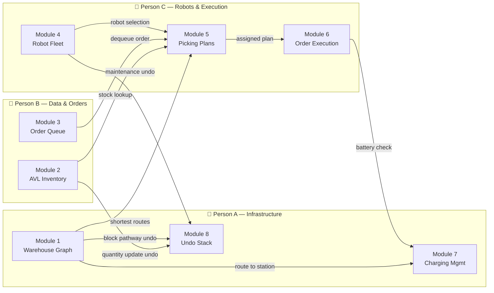
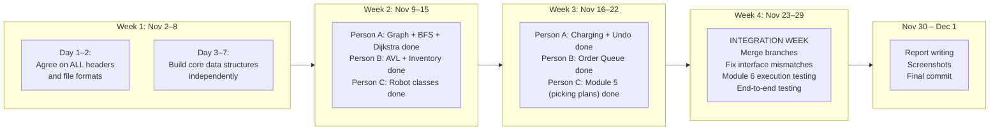

# 🏗️ Team Project Plan — Intelligent Warehouse Robot System

## Splitting 8 Modules Among 3 People for Independent Work

---

## 📋 Quick Reference

| Person | Modules | Core Data Structures | Estimated Weight |
|--------|---------|----------------------|------------------|
| **Person A** | Module 1 (Graph), Module 7 (Charging), Module 8 (Undo Stack) | Adjacency-List Graph, BFS, Dijkstra, Queue, Stack | ~35% |
| **Person B** | Module 2 (AVL/Inventory), Module 3 (Orders) | AVL Tree, Linked Lists, Queue | ~30% |
| **Person C** | Module 4 (Robots), Module 5 (Picking Plans), Module 6 (Execution) | Linked List, Inheritance (OOP), Plan Generation | ~35% |

---

## 🧩 Why This Split Works



Each person owns a **self-contained chunk**. The arrows above are **interface calls** — they cross boundaries but are handled through **shared header files** agreed upon on Day 1.

---

## 👤 Person A — Infrastructure & Support Systems

### Owns: Module 1 + Module 7 + Module 8

### Module 1: Warehouse Layout and Pathway Management

#### What You Build
An **undirected weighted graph** using a custom **adjacency list** (no STL). This is the foundation — every route in the entire system goes through your code.

#### Data Structures to Implement Manually
- **Adjacency List Graph** — each node holds a linked list of edges `(destinationID, distance, status)`
- **BFS** queue (manual linked-list queue)
- **Dijkstra's algorithm** with a manual min-priority extraction (no `priority_queue`)

#### Required Operations (Menu Items)
1. Load locations from `locations.txt` and pathways from `pathways.txt`
2. Display all locations and connections (mark BLOCKED pathways clearly)
3. Add a new location (unique ID, valid type: RACK / PACKING / CHARGING)
4. Add a pathway between two existing locations (distance > 0, no duplicates)
5. Remove a pathway (delete edge from both adjacency lists)
6. Block a pathway (keep edge, set status to BLOCKED) — **separate menu option from remove**
7. Reopen a blocked pathway
8. Search for a location by ID
9. **BFS**: Determine whether two locations are connected (ignoring BLOCKED pathways)
10. **Dijkstra**: Find shortest route between two locations (ignoring BLOCKED pathways)
11. Display route as a sequence of locations with total distance, or report "no route"

#### Rules You Must Follow
| Rule | Detail |
|------|--------|
| BLOCKED pathways | BFS and Dijkstra **must ignore** them entirely |
| Dijkstra tie-break | Equal distance → fewer locations. Still tied → any deterministic rule **but document it** |
| Invalid endpoints | If start or end location doesn't exist → fail clearly with a message |
| Location types | Every node is one of: `RACK`, `PACKING`, `CHARGING` |
| Rack → Location mapping | Loaded from `racks.txt`. Rack RK04 is at location L05, etc. Routing to a rack = routing to its location |
| Charging station → Location | Loaded from `chargers.txt`. Each station C## is at a CHARGING location with a fixed slot count |

#### Example Scenario (For Testing)
> Robot at L01 must reach rack location L08.
> - Route A: L01→L03→L05→L08, distance 14
> - Route B: L01→L02→L06→L08, distance 11
> System selects Route B.
> If L02–L06 is blocked → system returns Route A (distance 14).

#### Files You Own
| File | Purpose |
|------|---------|
| `Graph.h` / `Graph.cpp` | Adjacency list, add/remove/block/reopen edge |
| `Location.h` | Location struct (ID, type, name) |
| `Dijkstra.h` / `Dijkstra.cpp` | Shortest path, returns route + distance |
| `BFS.h` / `BFS.cpp` | Reachability check |
| `locations.txt` | Sample location data (min 15 locations) |
| `pathways.txt` | Sample pathway data |

#### What You Expose to Others (Your API)
```cpp
// Person B and C will call these — agree on the signatures on Day 1
struct Route {
    // linked list of location IDs, total distance
};

int  getDistance(const char* fromLocID, const char* toLocID);
Route getShortestRoute(const char* fromLocID, const char* toLocID);
bool isReachable(const char* fromLocID, const char* toLocID);
const char* getRackLocation(const char* rackID);  // RK04 → L05
```

---

### Module 7: Robot Battery and Charging Management

#### What You Build
Charging stations with limited slots and **FIFO waiting queues** (manual linked-list queues).

#### Data Structures
- **Linked list** of charging stations
- **FIFO queue** (linked list with front/rear pointers) per station for waiting robots

#### Required Operations
1. Display all charging stations: total/free slots, robots currently charging, waiting queue
2. Identify robots needing charging (battery < 20%)
3. Find nearest reachable station with a free slot (uses **your own Dijkstra**)
4. Check if a slot is available
5. Add robot to a station's waiting queue
6. Start charging an eligible robot
7. Complete charging (menu command) → battery = 100%, free slot, auto-start next in queue
8. Update robot's battery level
9. Remove a robot from the charging queue (returns to Available)
10. Return a charged robot to Available

#### Rules You Must Follow
| Rule | Detail |
|------|--------|
| Needs charging | Battery < 20% |
| Who can charge | Only `Available` or `Waiting for Charging` robots. **Not** robots with active tasks |
| Station choice | Nearest reachable station with a free slot. No free slot → join queue of nearest reachable station. Ties → smaller station ID |
| Cannot reach any station | Report the problem; robot must be set Unavailable manually |
| Charging starts | Status → `Charging`, location → station's location |
| Charging completes | Battery → 100%, free slot, status → `Available`, auto-start front-of-queue robot |
| Battery travel check | Robot must have enough battery to travel to the station |

#### Example Scenario
> Station C01: 1 slot. RB02 is charging. Queue: Front→RB01→RB03→NULL.
> RB02 completes → RB01 starts charging. Queue: Front→RB03→NULL.

#### Files You Own
| File | Purpose |
|------|---------|
| `ChargingStation.h` / `.cpp` | Station struct, slot management |
| `ChargingQueue.h` / `.cpp` | Per-station FIFO queue |
| `ChargingManager.h` / `.cpp` | Station selection logic, orchestration |
| `chargers.txt` | Sample charging station data |

#### Dependency on Others
- You call **Person C's** `Robot` getters/setters to read/update battery, status, location
- You use **your own** Dijkstra to find nearest station

---

### Module 8: Operation History and Undo Management

#### What You Build
A **stack** (manual linked-list stack) storing reversible operations.

#### Data Structures
- **Stack** (linked list, push/pop from top)

#### Reversible Operations
| Operation | What to Store | Undo Rejected When |
|-----------|--------------|-------------------|
| Manual quantity update (Module 2) | ProductID, RackID, old quantity, new quantity | Restored qty < reserved qty, or rack entry gone |
| Block pathway (Module 1) | Pathway endpoints, old status | Never rejected (just reopens) |
| Robot maintenance change (Module 4) | RobotID, old status | Robot now has active task or is charging |

#### Required Operations
1. Record reversible operations when they happen
2. Display the most recent operation (peek)
3. Undo most recent eligible operation (pop, restore, report)
4. Restore previous values exactly
5. Reject undo if it would violate consistency — entry **stays** on stack, show reason
6. Menu option to **discard** top entry without undoing

#### Rules You Must Follow
| Rule | Detail |
|------|--------|
| Executed trips/deliveries | **Never** added to the undo stack |
| Rejected undo | Entry stays on stack, reason is shown, system state unchanged |
| Discard option | Must exist as a separate menu option |

#### Dependency on Others
- You call Person B's inventory functions to check/restore quantities
- You call your own pathway functions to reopen pathways
- You call Person C's robot functions to check/restore maintenance status

#### Files You Own
| File | Purpose |
|------|---------|
| `UndoStack.h` / `.cpp` | Stack implementation + operation records |
| `UndoManager.h` / `.cpp` | Undo validation and execution |

---

## 👤 Person B — Data Layer (Inventory + Orders)

### Owns: Module 2 + Module 3

### Module 2: Product Inventory and Storage Rack Management

#### What You Build
An **AVL tree** indexing products. Each AVL node points to a **linked list** of rack entries. Each rack entry has a **linked list** of reservation records.

#### Data Structures to Implement Manually
- **AVL Tree** (with rotations: LL, RR, LR, RL, balance factors, height tracking)
- **Singly Linked List** for rack entries per product
- **Singly Linked List** for reservation records per rack entry

#### Required Operations
1. Insert a new product (reject duplicate IDs)
2. Delete a product (keep tree balanced) — **reject if any rack holds a reservation**
3. Search for a product by ID
4. Add a rack entry to a product's rack list (rack must exist in `racks.txt`; no duplicate rack per product)
5. Update quantity of a product in a rack (administrative adjustment — new total ≥ 0 and ≥ reserved qty)
6. Remove a rack entry **only** when total = 0 AND reserved = 0
7. Display all racks for a product: total, reserved, available quantities
8. Calculate total stock across all racks for a product
9. Calculate available stock (total − reserved) across all racks
10. Display products whose available stock < reorder level
11. Prevent deletion if any reservation exists

#### Rack Allocation Rule (Critical — Person C will call this)
When allocating product to racks, given a reference location:
1. Consider only racks with available qty > 0 **and** reachable via Dijkstra
2. If ≥1 rack can supply the entire remaining quantity → choose **nearest** such rack
   - Tie-break: larger available quantity → smaller RackID
3. Otherwise take **all** available stock from the nearest rack (same tie-breaks) → repeat with remaining
4. **Never** just take the first rack in the list

#### Shortage Rule
- If total available < requested → order cannot be fully reserved
- Default: report shortage, leave order Pending
- User may choose to reserve only available quantity → status becomes `Partially Fulfilled` only after at least one delivery

#### Rules You Must Follow
| Rule | Detail |
|------|--------|
| AVL balance | Tree must stay balanced after every insert/delete |
| Available qty | = total − reserved. Always. |
| Reservation records | Sum of reservation records = reserved qty per rack |
| No negative stock | Quantity updates cannot make total < 0 or total < reserved |
| Rack existence | Adding a rack entry → verify rack exists in `racks.txt` |
| Product data | ProductID, name, unit weight (kg), reorder level |
| Rack entry data | RackID, total qty, reserved qty, linked list of (OrderID, qty) |

#### Example Scenario (For Testing)
> P101 in three racks:
> | Rack | Total | Reserved | Available |
> |------|-------|----------|-----------|
> | RK01 | 10 | 3 | 7 |
> | RK04 | 8 | 0 | 8 |
> | RK07 | 12 | 5 | 7 |
> 
> Order requests 18 units. Robot distances: RK01=6, RK04=9, RK07=11.
> Allocation: RK01→7, RK04→8, RK07→3. Reserved becomes 10, 8, 8.

#### Files You Own
| File | Purpose |
|------|---------|
| `AVLTree.h` / `.cpp` | Generic or product-specific AVL tree |
| `Product.h` / `.cpp` | Product struct |
| `RackEntry.h` / `.cpp` | Rack entry with reservation list |
| `InventoryManager.h` / `.cpp` | All inventory operations, rack allocation |
| `products.txt` | Sample product data (min 10 products) |
| `inventory.txt` | Sample rack-to-product stock data |
| `racks.txt` | Rack-to-location mapping |

#### What You Expose to Others (Your API)
```cpp
// Person C will call these heavily
struct RackAllocation {
    // linked list of (rackID, quantity) pairs
};

Product* searchProduct(const char* productID);
double getUnitWeight(const char* productID);
int getAvailableStock(const char* productID);
RackAllocation allocateRacks(const char* productID, int qty, const char* referenceLocation);
bool reserveStock(RackAllocation* alloc, const char* orderID);
void releaseReservation(const char* orderID, const char* productID, const char* rackID, int qty);
void deductStock(const char* productID, const char* rackID, int qty, const char* orderID);
```

---

### Module 3: Customer Order Management

#### What You Build
A **linked list** of all orders + a **FIFO queue** (linked list with front/rear) for pending orders.

#### Data Structures
- **Linked list** — master order list
- **Linked list** — per-order item list (ProductID, required qty, delivered qty)
- **Queue** (linked list with front + rear pointers) — pending order queue

#### Required Operations
1. Load orders from `orders.txt`
2. Add a new customer order
3. Add multiple products to an order
4. Search for an order by ID
5. Enqueue pending orders into the queue
6. Display pending orders front → rear (**without** removing them)
7. Peek front order + queue size
8. Cancel an order
9. Remove cancelled orders from the queue
10. Update order status after robot assignment / product collection
11. Display completed and pending orders
12. Prevent duplicate Order IDs

#### Order Statuses
`Pending` → `Reserved` → `Assigned` → `Partially Fulfilled` → `Completed`
Or: `Pending` / `Reserved` / `Assigned` → `Cancelled`

#### Rules You Must Follow
| Rule | Detail |
|------|--------|
| Queue = FIFO | New orders join at rear. Front = oldest pending. File order = enqueue order |
| Only Pending in queue | Once selected for processing, order leaves the queue |
| Cancel from queue | Linear scan O(n) to find and remove from queue |
| Unique Order IDs | Reject duplicates |
| Product validation | Products must exist in AVL tree; quantities > 0 |
| Duplicate product in order | Merge quantities |
| Add items | Only to Pending orders |
| Cancel allowed | Pending, Reserved, Assigned (no trips started). **Must release reservations and free robot** |
| Cancel blocked | Partially Fulfilled or Completed orders **cannot** be cancelled |

#### Example Scenario
> Queue: O101→O102→O103→O104.
> O102 cancelled while Pending → Queue: O101→O103→O104.

#### Files You Own
| File | Purpose |
|------|---------|
| `Order.h` / `.cpp` | Order struct, item list |
| `OrderList.h` / `.cpp` | Master linked list of orders |
| `OrderQueue.h` / `.cpp` | FIFO queue for pending orders |
| `OrderManager.h` / `.cpp` | All order operations |
| `orders.txt` | Sample order data (min 10 orders per spec) |

#### What You Expose to Others
```cpp
Order* peekFrontOrder();
Order* dequeueOrder();          // Person C calls this
void   requeueAtFront(Order*);  // if re-planning is needed
Order* searchOrder(const char* orderID);
void   updateOrderStatus(const char* orderID, OrderStatus newStatus);
void   updateDeliveredQty(const char* orderID, const char* productID, int deliveredQty);
```

---

## 👤 Person C — Robot Fleet & Intelligence

### Owns: Module 4 + Module 5 + Module 6

### Module 4: Robot Fleet Management

#### What You Build
A **linked list** of robots with **inheritance**: base class `Robot`, derived classes `Picker`, `Carrier`, `HeavyDuty`.

#### Data Structures
- **Linked list** of Robot pointers (polymorphism)

#### Robot Types & Constraints
| Type | Capacity | Battery Rate | Eligibility Rule |
|------|----------|-------------|-----------------|
| Picker | up to 15 kg | 0.20 | Cannot carry product with unit weight > 5 kg |
| Carrier | 15–30 kg | 0.25 | No restriction |
| Heavy-duty | up to 60 kg | 0.35 | Only for orders with total weight > 15 kg, or containing a product with unit weight > 10 kg |

#### Required Operations
1. Load robots from `robots.txt`
2. Register a new robot (unique ID, valid location)
3. Search by ID
4. Display all robots with statuses
5. Display available robots
6. Update battery level (0–100)
7. Assign robot to an order/task
8. Release robot after task (→ Available; if battery < 20% → flag for charging)
9. Mark unavailable for maintenance / return from maintenance (**only** when no active task and not charging)
10. Prevent robot from holding > 1 active assignment

#### Robot Statuses
`Available`, `Assigned`, `Waiting for Charging`, `Charging`, `Unavailable`

#### Rules You Must Follow
| Rule | Detail |
|------|--------|
| Capacity validation | Loaded robot whose capacity violates type limit → rejected |
| Battery formula | `distance × rate × (1 + 0.5 × carriedWeight / maxCapacity)` |
| Safety reserve | Plan starts only if battery ≥ estimated consumption + 10% |
| Needs charging | Battery < 20% |
| Charging result | Completing charge → battery = 100% |
| Battery display | Stored as `double`, displayed with 1 decimal place |
| Distances | Positive integers |
| One assignment max | No multi-tasking |

#### Files You Own
| File | Purpose |
|------|---------|
| `Robot.h` / `.cpp` | Base class |
| `Picker.h` / `.cpp` | Derived |
| `Carrier.h` / `.cpp` | Derived |
| `HeavyDuty.h` / `.cpp` | Derived |
| `RobotList.h` / `.cpp` | Linked list + all robot operations |
| `robots.txt` | Sample robot data (min 5, at least one of each type) |

#### What You Expose to Others
```cpp
Robot* searchRobot(const char* robotID);
Robot* getAvailableRobots();  // returns filtered linked list
void   assignRobot(const char* robotID, const char* orderID);
void   releaseRobot(const char* robotID);
void   updateBattery(const char* robotID, double newLevel);
void   updateLocation(const char* robotID, const char* locationID);
```

---

### Module 5: Intelligent Robot Assignment and Picking Plan Generation

> [!IMPORTANT]
> This is the **major module** — the brain of the system. It ties together the graph (Person A), inventory (Person B), orders (Person B), and robots (you).

#### What You Build
The logic that takes an order, finds the best robot, generates a multi-trip picking plan, and reserves inventory.

#### Required Operations
1. Retrieve oldest eligible pending order from queue front. If shortage → report, try next. Skipped orders keep position
2. Search each required product in AVL tree (call Person B)
3. Traverse rack lists for each product (call Person B)
4. Check available quantities
5. Identify eligible robots (Available + type rule + can carry heaviest unit + battery sufficient)
6. Calculate routes using Dijkstra (call Person A)
7. Generate picking plan using the **nearest-reachable-rack heuristic**
8. Divide into multiple trips if needed
9. Reserve inventory after user confirms — **all-or-nothing**
10. Update robot status → Assigned, order status → Reserved then Assigned

#### The Heuristic: Nearest-Reachable-Rack
1. Allocate stock to racks using Module 2's rack allocation rule (call Person B)
2. Build visit sequence: from robot's location, repeatedly go to **nearest** unvisited planned rack (Dijkstra). Ties → smaller RackID
3. Build trips: add stops until next unit would exceed capacity. Split stop quantities by whole units across trips. When trip full → route to **nearest packing station**, unload, start next trip from there
4. After last pickup of last trip → route to nearest packing station
5. Compute distance and battery **leg by leg** using the formula

#### Robot Selection Rule
For each eligible robot, build a plan, then pick:
1. **Fewest trips** (single-trip always preferred)
2. **Smallest total travel distance**
3. **Smallest RobotID**

If no robot feasible → report reason (capacity / battery / eligibility / none available). For battery → suggest charging.

#### Example Scenario
> O105: P01×5 (2kg), P02×4 (1kg), P03×3 (3kg). Total: 23kg.
> | Robot | Cap | Battery | Trips |
> |-------|-----|---------|-------|
> | RB01 | 10kg | 85% | 3 (Picker) |
> | RB02 | 20kg | 60% | 2 (Carrier) |
> | RB03 | 30kg | 90% | 1 (Heavy-duty, eligible: >15kg) |
> 
> RB03 selected: 1 trip, if battery covers estimated + 10%.

#### Files You Own
| File | Purpose |
|------|---------|
| `PickingPlan.h` / `.cpp` | Plan struct, trip struct, leg struct |
| `PlanGenerator.h` / `.cpp` | Heuristic, robot selection, plan building |

---

### Module 6: Order Picking and Delivery Execution

#### What You Build
Execute an assigned plan trip by trip through the console.

#### Required Operations
1. Display assigned robot and picking plan
2. Validate every pathway on planned routes is still OPEN
3. Recalculate route if network changed (call Person A's Dijkstra)
4. Check robot's battery and carrying capacity
5. Collect products from planned racks
6. Update rack quantities and reservations (call Person B)
7. Update robot's location and battery
8. Deliver products to packing station
9. Update delivered quantities in the order (call Person B)
10. Release robot after final trip

#### Consistency Rules You Must Follow
| Rule | Detail |
|------|--------|
| Validate first | Check routes, battery (consumption + reserve), capacity, stock **before** changing any data |
| No double deduction | Each stop has a `collected` flag. Collected stop cannot be collected again |
| On collection | Rack total and reserved **both** decrease. Reservation record is reduced |
| Completed | Only when delivered qty = ordered qty for **every** item |
| Partially Fulfilled | After some but not all deliveries |
| Recalculate Route | Re-runs Dijkstra between same stops. If rack unreachable → offer Cancel Assignment |
| Cancel Assignment | Release uncollected reservations, free robot, return order to Pending at **front** of queue. Already-delivered items stay |
| **Executed trips are NEVER added to undo stack** | — |

#### Console Output Example
```
=====================================
 EXECUTE PICKING TASK
=====================================
Order ID:    O105
Assigned Robot: RB03

Trip 1:
  Start: L01
  Visit Rack RK04
    Collect P01: 5 units
  Visit Rack RK07
    Collect P02: 4 units
  Visit Rack RK09
    Collect P03: 3 units
  Destination: Packing Station L12
  Total Distance: 28 units
  Total Weight:   23 kg
  Estimated Battery Consumption: 14%

1. Execute Trip
2. Recalculate Route
3. Cancel Assignment
4. Assign but not execute now
```

#### Files You Own
| File | Purpose |
|------|---------|
| `Executor.h` / `.cpp` | Trip execution, validation, delivery |

---

## 🔗 Integration Contracts (Agree on Day 1!)

> [!IMPORTANT]
> Before anyone writes a single line of code, all three people must agree on the **shared header files** that define the interfaces between modules. This is what makes independent work possible.

### Shared Header: `Common.h`

```cpp
// Identifier formats — everyone uses these
// Location: L + digits     (L01)
// Rack:     RK + digits    (RK04)
// Product:  P + digits     (P101)
// Robot:    RB + digits    (RB01)
// Charger:  C + digits     (C01)
// Order:    O + digits     (O101)
// Customer: CU + digits    (CU12)

enum LocationType { RACK, PACKING, CHARGING };
enum RobotType    { PICKER, CARRIER, HEAVY_DUTY };
enum RobotStatus  { AVAILABLE, ASSIGNED, WAITING_FOR_CHARGING, CHARGING_STATUS, UNAVAILABLE };
enum OrderStatus  { PENDING, RESERVED, ASSIGNED_ORDER, PARTIALLY_FULFILLED, COMPLETED, CANCELLED };
```

### Integration Points Summary

| Caller → Provider | Function Needed | When |
|-------------------|----------------|------|
| C → A | `getShortestRoute()`, `getDistance()` | Building picking plans, checking routes |
| C → B | `allocateRacks()`, `reserveStock()`, `deductStock()`, `releaseReservation()` | Stock allocation, reservation, collection |
| C → B | `peekFrontOrder()`, `dequeueOrder()`, `requeueAtFront()` | Getting orders to process |
| A → C | `getRobotStatus()`, `updateBattery()`, `updateLocation()` | Charging management |
| A → B | `getReservedQty()` | Undo validation for quantity updates |
| A → C | `getRobotStatus()` | Undo validation for maintenance changes |

---

## 📅 Recommended Timeline (30 Days: Nov 2 → Dec 1)



---

## 🌿 Git Strategy

> [!CAUTION]
> The #1 risk of independent work is **merge conflicts**. Follow this strategy strictly.

### Branch Structure

```
main
├── feature/person-a-graph          (Module 1)
├── feature/person-a-charging       (Module 7)
├── feature/person-a-undo           (Module 8)
├── feature/person-b-inventory      (Module 2)
├── feature/person-b-orders         (Module 3)
├── feature/person-c-robots         (Module 4)
├── feature/person-c-picking-plan   (Module 5)
├── feature/person-c-execution      (Module 6)
└── integration                     (merge target before main)
```

### Git Rules

1. **Never push directly to `main`**. Always work on your feature branch
2. **Each person owns their files** — never edit someone else's `.cpp` files
3. **Shared headers** (`Common.h`, interface headers) are edited **only after team agreement** via group chat
4. Use **meaningful commit messages**: `"Add Dijkstra with blocked-pathway filtering"` not `"update"`
5. **Pull `integration` branch daily** to stay in sync
6. **Integration merges happen together** — schedule a call/meet

### Commit Naming Convention (From Project Rules)
> *"Use understandable and meaningful name of variables, files, and GitHub commits."*

Format: `[Module X] Brief description`
- `[Module 1] Implement adjacency list graph with load from file`
- `[Module 2] Add AVL tree insert with LL and RR rotations`
- `[Module 5] Implement nearest-reachable-rack heuristic`

---

## ⚠️ Problems You WILL Face (And How to Handle Them)

### Problem 1: Interface Mismatch
> Person C calls `getDistance("L01", "L08")` but Person A implemented `getDistance(int fromIndex, int toIndex)`

**Solution:** Agree on **exact function signatures** on Day 1. Write stub headers with the signatures. Everyone includes the same headers.

### Problem 2: Different String Handling
> Person A uses `char*`, Person B uses `std::string`, Person C uses fixed `char[20]`

**Solution:** Everyone uses `std::string` (it's allowed by the rules). Or everyone uses `char*`. Decide once.

### Problem 3: Circular Dependencies
> Module 5 needs Module 1 (routes), Module 2 (stock), Module 3 (orders), Module 4 (robots). Module 7 needs Module 1 (routes) and Module 4 (robots).

**Solution:** Use **forward declarations** in headers. Only `#include` in `.cpp` files. Keep headers minimal.

### Problem 4: Undo Stack Needs Everyone's Data
> Module 8 must undo operations from Modules 1, 2, and 4 — owned by all three people.

**Solution:** Person A owns the stack, but each person implements a `revert()` function for their own operations. Person A's undo manager calls those functions.

```cpp
// Person A writes the stack and calls:
bool revertQuantityUpdate(/*params*/);  // Person B implements
bool revertMaintenance(/*params*/);     // Person C implements
bool revertBlockPathway(/*params*/);    // Person A implements
```

### Problem 5: Test Data Inconsistency
> Person A's `locations.txt` has 15 locations but Person B's `racks.txt` references locations that don't exist.

**Solution:** Create **all sample data files together** on Day 1-2. Put them in a `/data/` folder in the repo. Everyone uses the same files.

### Problem 6: `main.cpp` Conflicts
> Everyone wants to add their menu options to `main.cpp`.

**Solution:** 
- Each person writes a **module-level menu function**: `showGraphMenu()`, `showInventoryMenu()`, `showOrderMenu()`, etc.
- One person (Person A suggested) owns `main.cpp` which only has the top-level menu calling these functions
- Each person's menu function lives in **their own files**

```cpp
// main.cpp (Person A owns this)
int main() {
    // load all data
    while (true) {
        cout << "1. Warehouse Layout\n";      // calls Person A's showGraphMenu()
        cout << "2. Product Inventory\n";      // calls Person B's showInventoryMenu()
        cout << "3. Customer Orders\n";        // calls Person B's showOrderMenu()
        cout << "4. Robot Fleet\n";            // calls Person C's showRobotMenu()
        cout << "5. Process Order\n";          // calls Person C's showPickingMenu()
        cout << "6. Execute Order\n";          // calls Person C's showExecutionMenu()
        cout << "7. Charging Management\n";    // calls Person A's showChargingMenu()
        cout << "8. Undo History\n";           // calls Person A's showUndoMenu()
        cout << "0. Exit\n";
    }
}
```

### Problem 7: Memory Leaks at Boundaries
> Person C creates a `Route` object using Person A's code. Who deletes it?

**Solution:** Document ownership. Rule of thumb: **the allocator frees**. If `getShortestRoute()` returns a `new Route`, Person A provides `freeRoute(Route*)`.

### Problem 8: One Person Falls Behind
> Person C's Module 5 is the hardest and takes longest. Integration stalls.

**Solution:**
- Person C should start Module 5 in Week 2, not Week 3
- Person A and B should write **stub/mock versions** of their APIs early so Person C can test without waiting
- If Person C is stuck, Person A (who owns Dijkstra) can help with the route-calculation parts of Module 5

---

## 📏 Project Rules Checklist (For Everyone)

> [!WARNING]
> Each of these carries marks. Ignore them at your own risk.

| # | Rule | Applies To |
|---|------|-----------|
| 1 | Proper **human-written comments** for every functionality | Everyone |
| 2 | Meaningful variable/file/commit names | Everyone |
| 3 | Proper **indentation** | Everyone |
| 4 | Think first, **draw logic on paper** before coding | Everyone |
| 5 | Code in **MS Visual Studio C++**, perform debugging | Everyone |
| 6 | MS Word report: repo link, code, screenshots, introduction, explanation | Shared task |
| 7 | Report submitted on **GCR** (not printed) | One person submits |
| 8 | Code submitted via **GitHub** | Everyone pushes |
| 9 | **No AI/Peer plagiarism** — negative marking or zero | Everyone |
| 10 | Submit on **GCR + GitHub** by deadline (Dec 1) — **deadline will NOT change** | Everyone |
| 11 | Team size: **2–3 members** | ✅ 3 members |

### Implementation Constraints (For Everyone)

| Constraint | Detail |
|------------|--------|
| **No STL containers** | No `vector`, `list`, `map`, `set`, `stack`, `queue`, `priority_queue`, `deque`, `unordered_map`, `unordered_set` |
| **Allowed** | `string`, `iostream`, `fstream`, `sstream`, `iomanip`, `cmath`, `climits` |
| **Manual memory** | `new` and `delete`. Every class with memory needs a **destructor** |
| **No smart pointers** | No `unique_ptr`, `shared_ptr` |
| **No memory leaks** | Leaks lose marks |
| **Fixed arrays** | Only for small bounded data (input buffers, slot arrays). Cannot replace required structures |
| **Input validation** | All menu input validated. Program **must not crash** on bad input |
| **No hardcoding** | Everything loaded from files |

---

## 📄 Report Division

| Section | Person |
|---------|--------|
| Introduction & Project Overview | Person A |
| Module 1, 7, 8 explanation + screenshots | Person A |
| Module 2, 3 explanation + screenshots | Person B |
| Module 4, 5, 6 explanation + screenshots | Person C |
| Integration description + repo link | All contribute, Person A compiles |

---

## ✅ Final Checklist Before Submission

- [ ] All 8 modules working end-to-end
- [ ] Min 15 locations, 10 products, 5 robots, 10 orders in test data
- [ ] At least 4 orders in known sequence (test FIFO)
- [ ] At least 1 order with stock shortage
- [ ] At least 1 order heavier than any single-robot single-trip
- [ ] No STL containers in core logic
- [ ] All destructors written, no memory leaks
- [ ] All input validated, no crashes
- [ ] Meaningful comments on every function
- [ ] Meaningful commit history on GitHub
- [ ] Word report with screenshots, repo link, code
- [ ] Submitted on GCR + GitHub before Dec 1
